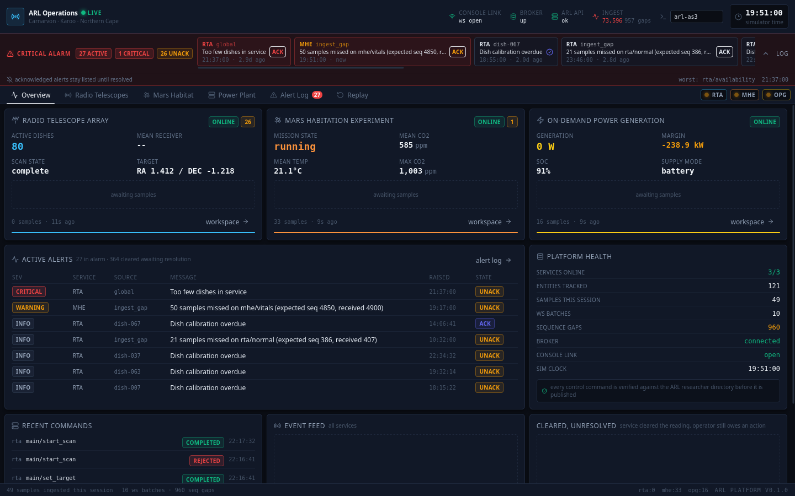
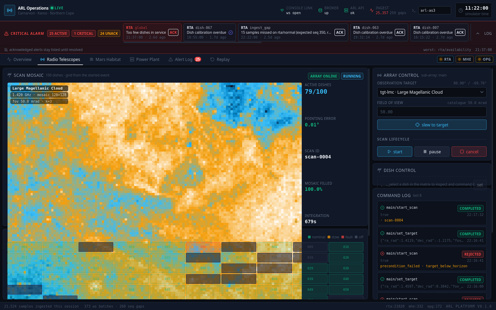
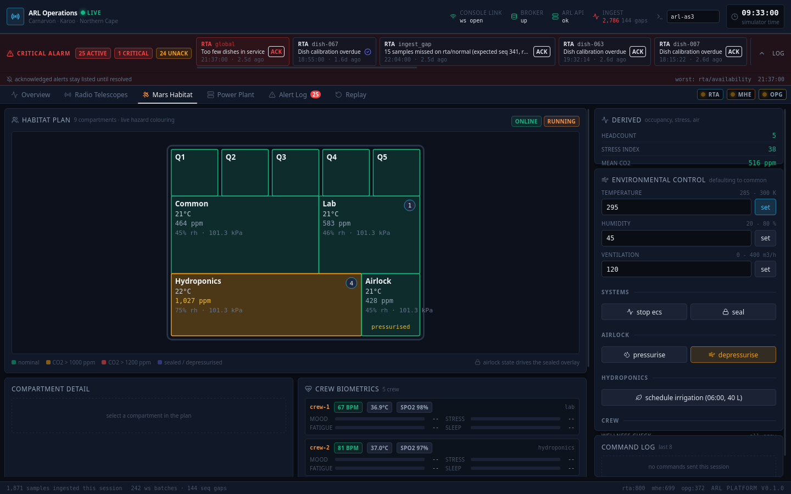
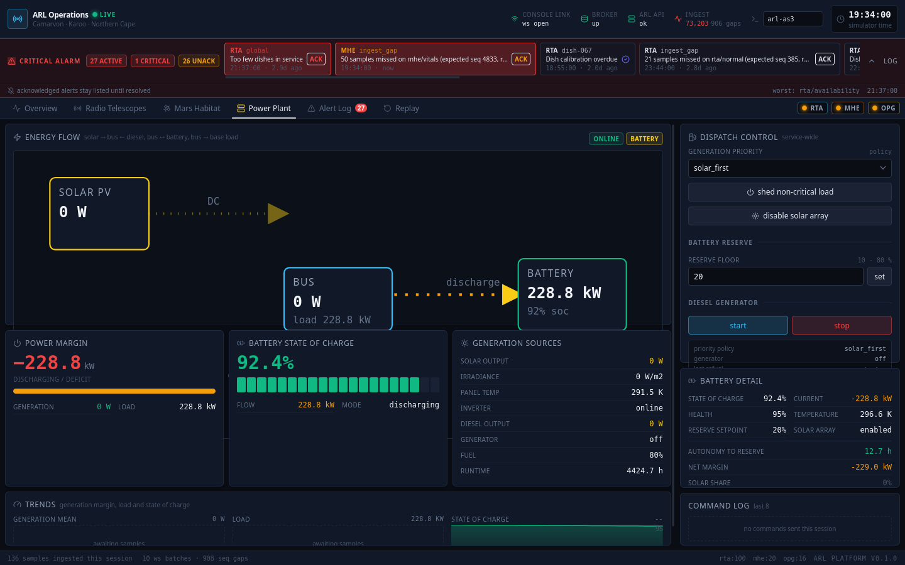
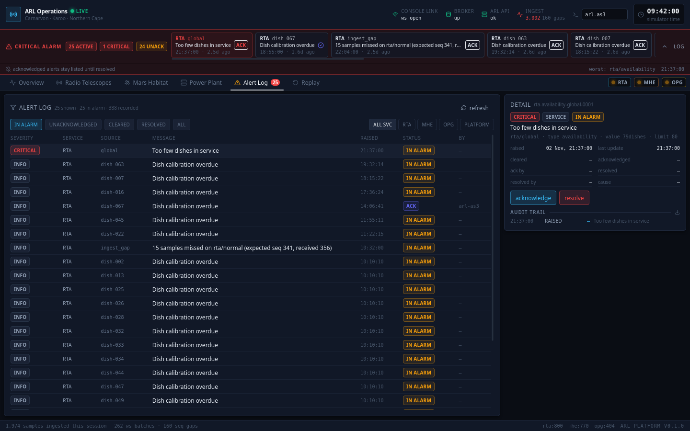
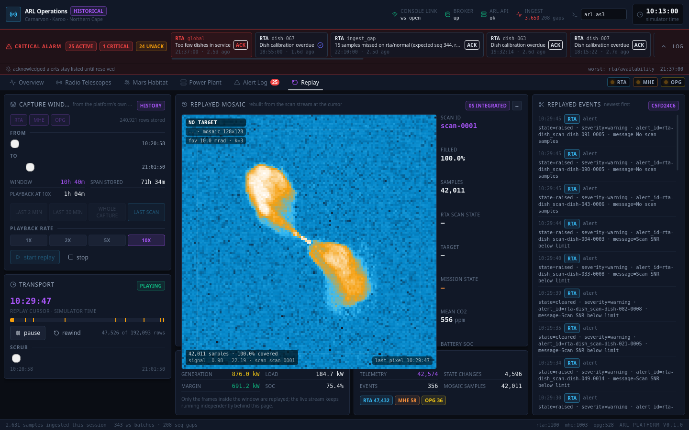

# ARL Operations Platform — COMS3011A SDP Exam 2026

A web-based monitoring, alerting and replay platform for the Astro-Research Laboratory (ARL) near
Carnarvon, Northern Cape. It ingests live telemetry from three laboratory services over MQTT,
persists it, visualises it, raises and manages alerts, and replays captured history.

This README is the single entry point for the project **and the live progress tracker** for the exam.
Decisions, decision changes, implemented features, known bugs and open questions are recorded here as
they happen (see [Progress Log](#progress-log) and [Decision Register](#decision-register)).

**Student number 2800269.** The graded repository is `2800269-sdp-exam-2026`, private, on
`sdp.ms.wits.ac.za` — this workspace's `origin`.

> Running the ARL sim locally: see [Running Locally](#running-locally).
> Running the platform: see [Running the Platform](#running-the-platform).
> What it looks like: see [Screenshots](#screenshots).
> Running the tests: see [Testing](#testing).

**Implementation plan.** The project is dismantled — first into components, then each component into
subsystems and subcomponents — across the numbered documents in `Planning Docs/`. Begin at
`Planning Docs/00-INDEX-AND-BLUEPRINT.md` for the file map, the rubric mapping, the defect register and
the delivery order. Three reading paths: *does it work?* → `00` then `52` §4.7 (drill results); *how is
RTA data handled?* → `20` → `03` → `04` → `11` → `22`; *where is the evidence for a rubric line?* →
`00` §3 and `53` §4.5.

---

## Scope

The exam requires three of the five ARL services. **Selected:**

| Slot | Weight | Service | Code | Status |
| --- | --- | --- | --- | --- |
| Required | 30% | Radio Telescope Array | `rta` | Implemented, verified live |
| Best of MHE / LWM | 17.5% | Mars Habitation Experiment | `mhe` | Implemented, verified live |
| Best of OPG / OWT | 17.5% | On-demand Power Generation | `opg` | Implemented, verified live |
| Platform | 10% | Alert system (annunciator + audit) | — | Implemented, verified live |
| Platform | 10% | Replay system | — | Implemented, verified live |
| Platform | 5% | Architecture | — | Implemented (shared shell + service plugins) |
| Platform | 5% | Security | — | Implemented, verified (403/503 gates) |
| Platform | 2.5% | UI / UX | — | Implemented (three workspaces, alerts, replay) |
| Platform | 2.5% | Testing | — | 97 tests, 7 files, passing |

Implementation order: **RTA → OPG → MHE**. The shared shell (ingestion, persistence, alerts, replay,
websocket push) is built first and is generic; each service then plugs in.

Rationale for order: the RTA is the required 30% and carries the highest data rate and the hardest
visualisation (2D scan reconstruction), so it drives the architecture. OPG is the sparsest and
cheapest service (4 entities, 1 message/minute, 6 controls) and validates that the shared shell really
is generic before spending time on MHE's larger alert and control surface.

Non-goals (explicitly out of scope per the brief): authentication of researchers, fixing the lab's
weak security, and the two unselected services.

---

## Chosen Stack

| Layer | Choice | Rationale |
| --- | --- | --- |
| Language | Node.js + TypeScript | One language and one set of types shared between server and browser; non-blocking I/O suits high-rate streams (RTA peaks near 90 msg/s). |
| HTTP framework | Express | Thin routing for control dispatch, researcher authorisation and replay range queries. |
| MQTT client | `mqtt` (mqtt.js) | Automatic reconnect, configurable backpressure queue, wildcard subscriptions for dynamic topic discovery. |
| Persistence | SQLite via `better-sqlite3` | Embedded, zero daemon (no Docker needed to run the platform). WAL mode + batched transactions give high write throughput without blocking the event loop. |
| Server→browser push | `ws` (WebSocket) | Low-overhead push of ingested deltas and alert transitions straight to the operator UI. |
| ARL API client | `axios` | Promise-based HTTP for researcher verification, target catalogue and alert limits. |
| UI | React + TypeScript + Vite | Fast builds/HMR, component isolation, dense operator UI. |
| Styling / graphics | Tailwind CSS, Lucide icons, HTML5 Canvas | Tailwind for dense operator layouts (status LEDs, split grids, always-visible annunciator); Canvas for pixel-level scan rasters and spatial maps without DOM overhead. |

---

## Architecture

Single deployment: one Node process serves the JSON/WebSocket API and the built SPA.

```
                        +---------------------------+
                        |   Browser (React SPA)     |
                        |  services · annunciator   |
                        |  replay · controls        |
                        +------+------------+-------+
                     REST  |            |  WebSocket (deltas)
                           v            v
+-----------------------------------------------------------------------+
|  Node / TypeScript server                                             |
|                                                                       |
|  config.ts        env only, no hard-coded credentials                 |
|  topology.ts      retained $topology per service -> entity/stream      |
|                   /state/event/control registry (drives everything)    |
|  mqtt/ingest.ts   wildcard subs per service, reconnect, seq-gap check  |
|  services/*       per-service adapters (presentation + transforms)     |
|  db/              SQLite WAL: batch writer, queries, migrations       |
|  alerts/engine.ts service alerts + platform alerts, lifecycle, audit   |
|  commands/        researcher verify (ARL API) -> publish -> await ack  |
|  replay/          range queries over captured data + virtual clock     |
|  http/            REST + static SPA + WebSocket broadcaster           |
+-------------------+---------------------+-----------------------------+
                    |                     |
          MQTT (sub/pub)            HTTP (axios, cached)
                    v                     v
        +---------------------+   +--------------------+
        |  ARL MQTT broker    |   |  ARL API /v1       |
        |  arl/<svc>/#         |   |  researchers       |
        +---------------------+   |  targets           |
                                  |  alert-limits      |
                                  +--------------------+
```

**Module names as built.** The block above names modules by role. The directories that implement those
roles are `config.ts`, `topology/registry.ts`, `mqtt/ingest.ts`, `db/`, `alerts/engine.ts`,
`commands/service.ts`, `services/`, `arlApi/client.ts`, `replay/session.ts`, `http/` and `platform/`.
`services/` holds one plugin per service — `rta.ts`, `mhe.ts`, `opg.ts` — behind the `ServicePlugin`
contract in `services/types.ts`. Nothing generic (ingest, store, alerts, replay, HTTP) imports a
plugin, and no plugin contains a topic string: a service is enumerated in exactly two places, the
configured service list and the topology it publishes.

Services are discovered, not hard-coded. Every service publishes a retained `$topology` describing
its entities, streams, state items, event kinds and controls; the platform subscribes to
`arl/+/$topology` and builds its routing table from whatever arrives. The brief's suggested
`arl/+/discovery` probe is not published by any of the three services (verified on the wire), so the
retained `$topology` is the discovery mechanism — it carries strictly more information and costs one
message per service instead of a probe plus a fetch.

### Service plugins and derived measures

Each plugin answers three questions about its own service and returns numbers, verdicts and the
inputs it used. Verdicts are compared against the limits the ARL API publishes for that service
(`GET /v1/alert-limits/<service>`); when a limit or an input is missing the measure reports `unknown`
rather than guessing.

| Plugin | Measure | Definition |
| --- | --- | --- |
| RTA | `rta.array_availability` | active dishes / dishes in `$topology`, checked against `availability.min_active` |
| RTA | `rta.pointing_error` | great-circle angle between commanded az/el (`state`) and achieved az/el (telemetry) |
| RTA | `rta.scan_progress` | mean progress across dishes currently reporting a `scan_id` |
| MHE | `mhe.headcount` | Σ `crew_count` across rooms vs the crew roster; a missing room warns, a mismatch is critical |
| MHE | `mhe.stress_index` | mean heart rate mapped onto 0–100 between resting (60) and ceiling (110) bpm, with mean CO₂ carried alongside |
| MHE | `mhe.co2_mean` | habitat mean CO₂ against `air.co2_warn_ppm` / `air.co2_crit_ppm` |
| OPG | `opg.net_margin` | `P_net = P_solar + P_diesel − P_load`; negative only escalates when the bank is also below `battery.warn_pct` |
| OPG | `opg.autonomy` | usable bank energy `(SoC − reserve)% × 4000 kWh` divided by the instantaneous discharge rate; only a discharging bank has a projection |
| OPG | `opg.renewable_share` | solar output / load; `unknown` at night, when a zero describes the clock rather than a fault |

Served at `GET /api/derived` (optionally `?service=opg`) and polled by all three workspaces.

### Data flow

1. Ingest subscribes to `arl/+/$topology`; each arrival builds a registry entry for entities, streams
   (with field names, types, units, periods), state items, event kinds and
   controls. **The registry drives ingestion, validation, rendering and control UI generation** — adding a
   device needs no ingestion change. Samples that arrive before their topology are held and replayed
   once it lands.
2. The same connection subscribes to `arl/+/+/telemetry/+`, `arl/+/+/state/+`, `arl/+/events/+` and
   `arl/+/ack/+`. Wildcards only: an entity or stream that did not exist when this code was written is
   still routed.
3. Messages are validated against the registry, stamped with both the envelope `ts` (simulated time) and
   the local receive time, then queued.
4. A batch writer flushes the queue to SQLite in one transaction (bounded by count and elapsed time), so
   burst rates do not translate into one transaction per message.
5. Deltas are pushed over WebSocket to the browser; alert events additionally go through the alert engine
   before broadcast.
6. Controls: the browser posts `{service, entity, control, value, researcher}`; the server verifies the
   researcher code against the ARL API (cached), publishes to `arl/<svc>/cmd/<entity>/<control>` with a
   freshly generated `command_id`, and correlates the resulting ack stream back to the UI.

### Time handling (important)

Envelope `ts` is **simulated** time and is the only clock used for ordering, charting and replay. Wall
clock is stored separately (`recv_ts`) and used only for ingestion health (gap detection, staleness).
This keeps replay correct when the sim runs at `ARL_SPEEDUP` > 1 and when services replay buffered
samples (`backfill: true`) out of order.

### Persistence model (SQLite, WAL)

| Table | Purpose |
| --- | --- |
| `service` | Per-service `online` state, last message, and the latest `$topology` JSON with its version. |
| `entity` | Entity ids, kinds and metadata (from `$topology`). |
| `telemetry` | `(service, entity, stream, ts, seq, data JSON, recv_ts)`; indexed for entity/stream/time range scans. |
| `state_change` | History of retained state items `(service, entity, item, ts, value)`. |
| `event` | Non-alert events (scan lifecycle, EVA, survey, refuel, backwash, lightning). |
| `alert` | One row per `alert_id`: type, severity, raised/cleared times, ack and resolve times **and researchers**, cause, resolution note. |
| `alert_transition` | Append-only audit of every alert transition (raised, escalated, cleared, acknowledged, resolved). |
| `command` | One row per `command_id`: control, value, researcher, sent time, terminal state, reason, detail. |
| `command_ack` | Append-only ack log (accepted → in_progress → completed/failed, progress). |
| `ingest_gap` | Detected `seq` discontinuities and heartbeat staleness per topic. |
| `researcher` | Last-known verified researcher codes (TTL cache), so a name still renders while the API is down. |

---

## MQTT contract (identical for every service)

```
arl/<svc>/$topology                 retained — machine-readable schema of the whole service
arl/<svc>/<entity>/telemetry/<st>   periodic measurements, envelope {v, ts, seq, entity}
arl/<svc>/<entity>/state/<item>     retained, {v, ts, entity, item, value}
arl/<svc>/events/<kind>             one-off events, including <kind> = alert
arl/<svc>/cmd/<entity>/<control>    platform -> service, {command_id, researcher, value}
arl/<svc>/ack/<command_id>          service -> platform, state/progress/reason/detail
```

- `null` measurements mean "could not be taken" and must not be charted as zero.
- `seq` is per-topic and restarts with the service; **gaps are recorded, not silently dropped**.
- Every service publishes `state/online` (last-will) and `state/active_alerts`.
- Alerts: `alert_id` is stable across escalation; `state` is `raised` or `cleared`; thresholds come from
  `GET /v1/alert-limits/<service>`, which is the single source of truth.

---

## Configuration

Everything is configured through environment variables. No credentials are committed.

| Variable | Required | Default | Purpose |
| --- | --- | --- | --- |
| `MQTT_BROKER_ADDRESS` | yes | — | MQTT broker host. |
| `MQTT_BROKER_PORT` | yes | — | MQTT broker port. |
| `MQTT_BROKER_USER` | no | empty | Broker username (anonymous when empty). |
| `MQTT_BROKER_PASSWORD` | no | empty | Broker password. |
| `ARL_API_ADDRESS` | yes | — | ARL API host. |
| `ARL_API_PORT` | yes | — | ARL API port. |
| `ARL_SERVICES` | no | `rta,mhe,opg` | Services to ingest. |
| `PORT` | no | `3000` | Platform HTTP/WebSocket port. |
| `DB_PATH` | no | `./data/arl.sqlite` | SQLite file. |
| `ARL_API_TIMEOUT_MS` | no | `5000` | ARL API request timeout. |
| `RESEARCHER_CACHE_TTL_S` | no | `60` | Researcher verification cache TTL. |
| `TELEMETRY_BATCH_MS` | no | `250` | Max delay before a batch flush. |
| `TELEMETRY_BATCH_ROWS` | no | `1000` | Max rows per batch flush. |
| `MQTT_CLIENT_ID` | no | `arl-platform-<pid>` | Broker client id. |
| `MQTT_QUEUE_LIMIT` | no | `50000` | Outgoing queue while the broker is slow. |
| `SERVICE_SILENCE_S` | no | `180` | Silence before the platform declares a feed stale. |
| `TELEMETRY_RETENTION_H` | no | `0` | Raw telemetry retention; 0 keeps everything. |
| `OPG_BATTERY_KWH` | no | `4000` | Nameplate bank energy used by `opg.autonomy`. |
| `MHE_CREW_EXPECTED` | no | `0` | Rated crew for `mhe.headcount`; 0 counts the topology's `crew` entities. |
| `STRESS_REST_BPM` / `STRESS_MAX_BPM` | no | `60` / `110` | Heart-rate ends of the crew stress index. |

Only the four `MQTT_*`/`ARL_API_*` address variables are mandatory; the rest have defaults. Nothing in
the repository contains a broker or API credential.

---

## Running Locally

### 1. The ARL simulator

The bundle unpacks to `arl-sim/` (`arl-test.yaml`, `config/*.toml`, `scenarios/`, `mosquitto/`,
`images/*.tar`, `bin/arl-*`). It needs an MQTT broker (Mosquitto), the ARL API and PostgreSQL for the
API's own store.

With Docker (the documented path):

```bash
cd arl-sim
docker load -i images/arl-api.tar          # and arl-rta, arl-mhe, arl-opg as needed
docker compose -f arl-test.yaml up -d api rta mhe opg
docker compose -f arl-test.yaml ps
```

With Podman (this machine has no Docker):

```bash
cd arl-sim
podman load -i images/arl-rta.tar          # etc.
podman-compose -f arl-test.yaml up -d api rta mhe opg
```

Useful knobs (prefix any of the commands above):

```bash
ARL_SPEEDUP=10 ARL_SEED=7 ARL_SCENARIO=/scenarios/example.toml \
  docker compose -f arl-test.yaml up -d rta
```

`ARL_SPEEDUP` caps: RTA 50, MHE 2000, LWM/OPG/OWT 500. Scenario faults are the way to exercise every
alert rule.

### 2. The platform

```bash
npm install
cp .env.example .env        # fill in broker and API details
npm run dev                 # server + web dev server
```

Production-style single process (server also serves the built SPA):

```bash
npm run build
npm start
```

---

## Running the Platform

After `npm run build && npm start`, open `http://localhost:3000`.

Navigation is hash-routed: `#/rta`, `#/mhe`, `#/opg`, `#/alerts`, `#/replay` (plus an overview).
The annunciator bar sits above every page and never scrolls away, so an alert raised on the RTA
workspace is visible while the operator is looking at OPG.

The platform does **not** authenticate users. Selecting a researcher code in the header is an
*identity for control actions*, not a login: monitoring, alerts and replay are visible to everyone;
mutating actions are attributed to, and gated by, the code's existence in the ARL directory.

| Surface | Behaviour |
| --- | --- |
| RTA workspace | 10×10 dish matrix (status/az-el/temperature), Canvas scan raster reconstructed client-side from 1 Hz scan packets, target/scan/stop controls |
| MHE workspace | room blueprint with O₂/CO₂/temperature/occupancy, crew vitals, derived headcount/stress/CO₂ panel, scrubber and airlock controls |
| OPG workspace | solar → bus → load energy flow, SoC gauge, diesel runtime and fuel, source-priority and load-shedding controls, autonomy and margin detail |
| Alerts | annunciator with severity ordering, acknowledge (code) and resolve (code + note), per-alert audit trail, transition history |
| Replay | window selection over captured history, play/pause/rewind/fast-forward, 1×/2×/5×/10×, scrub bar, alert correlation |

### REST surface

`GET /api/health`, `/services`, `/services/:service/topology`, `/series`, `/states`, `/range`,
`/targets`, `/derived`, `/alert-limits/:service`, `/researchers/:code`, `/alerts`, `/alerts/:id`,
`/commands`, `/commands/:id/acks`, `/replay`, `/replay/:id`.

`POST /api/commands`, `/alerts/:id/acknowledge`, `/alerts/:id/resolve`, `/replay`,
`/replay/:id/play|pause`, `/replay/:id/speed`, `/replay/:id/seek`; `DELETE /api/replay/:id`.
Every mutating route requires a `researcher` code that the server verifies itself — see
[Security Decisions](#security-decisions).

---

## Screenshots

Captured from the running platform against the live ARL simulator at 1440×900: real telemetry, not
fixtures. The RTA mosaic is a scan the page itself started, and the replay shot is a real session over
rows this platform captured.

### Overview — `#/overview`



The three workspaces in miniature (active dishes and target, mission state and CO₂, generation and
margin, SoC), the active-alert list with severity and inline acknowledgement, and platform health:
3/3 services, 121 entities, WebSocket batches, sequence gaps and broker state. OPG is running off the
bank after dark (0 W generated, margin −238.9 kW, supply mode `battery`), and the CRITICAL
`Too few dishes in service` is the RTA availability measure compared with the floor the service
publishes — 79 active against a limit of 80 when it was raised — so the annunciator and the derived
readout agree.

### RTA — `#/rta`



A 128×128 scan of the Large Magellanic Cloud at 1.420 GHz, rebuilt in Canvas from the 1 Hz scan
packets: 100 % of pixels filled, 79/100 dishes active, pointing error 0.01°, `scan-0004` running with
679 s of integration. The command log carries a rejected `start_scan` (`precondition failed · target
below horizon`) beside the accepted retry — the simulator's own reason codes are surfaced verbatim,
not translated into a generic failure.

### MHE — `#/mhe`



All nine compartments with live hazard colouring — Hydroponics is amber at 1,027 ppm CO₂ against
464–583 ppm elsewhere — beside the derived panel (headcount 5, stress index 38, mean CO₂ 516 ppm),
the environmental setpoints and the status tiles. The plan keeps its intrinsic aspect ratio and the
column scrolls, rather than the drawing overlapping its neighbours (see D14).

### OPG — `#/opg`



After dark: the array is at 0 W, so the bus is fed from the bank and the flow diagram names the mode
(`discharge`). Margin −228.8 kW in deficit, 92.4 % SoC, autonomy 12.7 h, solar share 0 %, with the
generation sources, dispatch controls and battery detail carrying the same numbers. Autonomy is
computed from the instantaneous discharge rate and the nameplate energy rather than assumed; when the
bank is idle it reads `—` with the reason `the bank is not discharging` instead of inventing a figure.
Dispatch is submitted under the researcher's own policy (`solar_first`), and this account is refused
permission to start the diesel generator by the ARL directory (`not_permitted`) — the least-privilege
gate doing its job, not a UI defect.

### Alerts — `#/alerts`



25 alerts in alarm, filterable by lifecycle state, each row carrying severity, source, message, raise
time and the researcher who acted. The detail panel shows the measured value against the limit that
produced it plus the append-only audit trail; acknowledge and resolve are the two actions that require
a code the server verifies before anything is written.

### Replay — `#/replay`



A replay session over this platform's own captured history (240,921 rows stored): the scrub bar
carries alert ticks so an operator can jump to the conditions behind a transition, playback runs at
10× with play/pause/rewind, the events list replays the alert stream at the cursor, and the mosaic is
rebuilt from the stored scan rows — not from the broker or the API backlog.

---

## Testing

```bash
npm test            # 97 tests across 7 files (vitest)
npm run test:watch
npm run --workspace server test:typecheck   # typecheck the tests too
```

The suite runs against the source, not `dist`, and every database is `:memory:` or a temp file, so
tests never touch `data/arl.sqlite`.

| File | Covers |
| --- | --- |
| `test/topology.test.ts` | `$topology` parsing (entity kinds, wildcarded streams, exact state topics), event/ack routing, control-to-entity matching, and the full control value validator (bool, enum, ranges, integers, object fields, timestamps) |
| `test/alerts.test.ts` | raise → escalate → clear → reopen, acknowledgement and resolution state machine (including 409s), audit trail contents, annunciator counters, platform alerts, engine input rejection, and the startup reconciliation that closes a broker alert a previous process left open |
| `test/persistence.test.ts` | WAL mode, durability across reopen, single-transaction batch writes, latest-sample read models, chart ranges, researcher TTL cache, command lifecycle and timeout |
| `test/replay.test.ts` | the three-source interleave (regression for the mosaic bug), seek-on-target, service filtering, speed/seek clamping, pause/stop semantics, session registry |
| `test/derived.test.ts` | every plugin measure including the OPG autonomy formula, MHE headcount mismatch, CO₂ escalation, night-time solar share, and `unknown` rather than invented values when nothing has arrived |
| `test/ingest.test.ts` | scenario-driven: topology after samples (orphan drain), wildcard routing, unconfigured services, sequence-gap alerts, state de-duplication, scalar retained state, alert events, offline flips |
| `test/api.test.ts` | supertest against the real Express app: derived endpoint, 400/403/503/409/200 on alert mutations with no audit write on refusal, replay lifecycle, health/services/alerts reads, JSON 404 |

These tests have already earned their keep: `?service=` on `/api/derived` was validated but never
applied until the API test failed, the replay interleave is pinned so the empty-mosaic regression
cannot return, and the broker-alert reconciliation is pinned so a restart cannot leave a stale
CRITICAL annunciator behind.

---

## Security Decisions

The lab's security is weak and out of scope; the requirement is not to weaken it further.

- **No authentication by design.** There is no login, no session, no password. Researcher *codes* are
  the lab's existing control mechanism and are only used to attribute and authorise mutating actions.
- **Least privilege on control.** Every control request is verified against the ARL API
  (`POST /v1/researchers/verify`) and cached briefly. A code that is unknown, defunct, or not permitted
  for the service cannot dispatch a command, and the UI explains why.
- **Alert mutations are researched too.** `POST /api/alerts/:id/acknowledge` and `/resolve` require a
  code that the server resolves against `GET /api/researchers/:code` **before** anything is written.
  An unknown code is `403 unknown_researcher`; if the directory itself is unreachable the answer is
  `503 api_unavailable` and nothing is recorded. Refusals leave the audit trail untouched — verified by
  test, not by inspection.
- **Fail closed.** The server owns verification and command construction; the browser cannot bypass it.
  Researcher codes are never trusted from client-supplied claims about permissions, and the client
  disables the confirm button until the code has been verified.
- **No hard-coded credentials.** Broker and API details come only from environment variables; `.env` is
  git-ignored. The API is read-only in the live deployment, so a leaked credential cannot write.
- **Input handling.** All inbound MQTT payloads are treated as untrusted: validated against the
  `$topology` registry, size-bounded, type-checked, and never evaluated or used to build SQL. All SQL is
  parameterised. Control values are validated against the control schema before publishing.
- **No secrets in the DB or logs.** Only the last four characters of a researcher code are logged for
  correlation.

---

## Decision Register

| # | Date | Decision | Why | Alternatives rejected |
| --- | --- | --- | --- | --- |
| D1 | 2026-11-02 | Node.js + TypeScript, Express, mqtt.js, better-sqlite3 (WAL), `ws`, axios, React + Vite, Tailwind + Canvas | Shared types end-to-end; embedded DB avoids a daemon; async I/O suits the RTA's 90 msg/s; Canvas handles pixel rasters and maps | Python/FastAPI (no shared types with UI); Postgres in Docker (extra moving part, no benefit at this scale) |
| D2 | 2026-11-02 | Services: RTA, MHE, OPG | RTA is mandatory and drives the architecture; MHE and OPG cover the other two slots (best-of grading means the pair is judged individually) | LWM (would duplicate RTA's spatial/map work); OWT (30-minute reporting makes replay and visualisation thin) |
| D3 | 2026-11-02 | Implementation order RTA → OPG → MHE | Build the shared shell against the hardest service, validate genericity on the simplest, then absorb MHE's larger surface | MHE first (large surface with unproven shell) |
| D4 | 2026-11-02 | Simulated `ts` is the only ordering/charting clock; wall clock kept separately | `ARL_SPEEDUP` and LWM/MHE backfill make wall clock wrong for replay | Ordering by receive time (breaks replay and backfill) |
| D5 | 2026-11-02 | `$topology`-driven generic ingestion and UI, with per-service adapter modules for presentation | Architecture rubric rewards services plugging into a shared shell through a common interface | Three hand-written integrations (highest score band unavailable) |
| D6 | 2026-11-02 | A state change is stored (and pushed) only when its value differs from the last one seen | The RTA republishes every dish's `commanded`/`enabled`/`stowed` items about once a second with an unchanged value; storing each repeat would make `state_change` grow at ~500 rows/s and bury real transitions | Storing every publish (volume without information); sampling state on a timer (misses short-lived transitions) |
| D7 | 2026-11-02 | Controls require a researcher code verified by the ARL API (fail closed). Alert acknowledge/resolve accept a well-formed code without the API, and resolve the name opportunistically **(superseded by D9)** | Losing the API must not block alarm handling, but it must block moving hardware. The audit trail records who either way | Verifying codes for acknowledgements too (an API outage would freeze the alarm panel); no code at all for alerts (no attribution) |
| D8 | 2026-11-02 | RTA image geometry (`grid_size`, `fov_rad`, `overlap`, `band_hz`, `dishes`) is read from the `events/scan` *started* payload, not from the target catalogue | Verified against the sim: the catalogue lists `fov_rad = 0.005` for `tgt-cen`, while the started event reports `fov_rad = 0.01`, `grid_size = 128`, `overlap = 3`. Using the catalogue would put every sample at the wrong pixel | Assuming a fixed 128 grid and the catalogue FOV (silently misplaced image) |
| **D9** | 2026-11-02 | **Decision change — reverses D7.** Alert acknowledge/resolve now require a code the server resolves against `GET /api/researchers/:code` before writing anything: `403 unknown_researcher`, `503 api_unavailable`, audit trail untouched. The client disables confirm until verified | The exam requires a signed audit trail for every alert transition, and an unverified code lets a typo — or anyone on the lab network — sign off an alarm with no accountable name. A 503 keeps the distinction between "wrong code" and "our dependency is down" | D7's optimistic acceptance (unattributable sign-off); accepting any well-formed code (same fault, faster) |
| D10 | 2026-11-02 | Service discovery is the retained `arl/+/$topology`, not the brief's `arl/+/discovery` probe | Probed the running broker: no service publishes anything under `discovery`. `$topology` is retained, arrives on subscribe, and carries the full entity/stream/state/event/control schema — strictly more than a discovery hint | Subscribing to a topic no service publishes (silent, unfalsifiable failure) |
| D11 | 2026-11-02 | Per-service derived measures live in `services/{rta,mhe,opg}.ts` behind a `ServicePlugin` contract, replacing the single `derived/measures.ts` | Each service answers its own questions and carries its own label/accent/focal kind; the shell imports the plugin table only, so no generic module can grow a `service === 'rta'` branch | One shared measures module with per-service branches (the code the refactor deleted) |
| D12 | 2026-11-02 | Every derived verdict is compared against the ARL alert limits the service publishes, and returns `unknown` when a limit or input is missing | A threshold duplicated in the UI drifts from the service's own rule set (this is defect D-10 in `00` §6); `unknown` is an honest answer, a fabricated zero is not | Literal thresholds in the client; substituting 0 for a missing sample |
| D13 | 2026-11-02 | Platform alerts are reconciled at startup, not only on a transition: `brokerConnected` starts `false` and `AlertEngine.start()` sweeps immediately | A CRITICAL `broker_disconnected` raised in one run survived the restart that fixed it and stayed red for the rest of the session, because the engine only clears on an edge it never saw. Now the first `connect` closes the old row and the first sweep clears stale silence/gap alerts; the close is an audit transition, not a deletion | Trusting the stored row (a lying red banner); deleting platform alerts on boot (destroys the trail of when the platform lost the broker) |
| D14 | 2026-11-02 | The MHE habitat plan is height-capped and never allowed to shrink (`max-h-[44vh]`, `max-w-[620px]`, `shrink-0` on its panel) | Sizing the SVG by width alone made it grow to the column width and paint over the compartment detail and crew strip below; letting the flex box squeeze it made the drawing (and its hit areas) unreadable. A fixed-aspect drawing scrolls the column instead | Absolute positioning over the layout (still overlaps); rasterising the plan to an image (loses live hazard colouring) |

---

## Progress Log

Newest first. Each entry: what changed, and why if non-obvious.

- **2026-11-02 — Submitted.** The graded repository `2800269-sdp-exam-2026` was created private on
  `sdp.ms.wits.ac.za` and `main` was pushed to it (`origin` now points there, not at `SDP_Exam`). Nothing
  about the code changed: this is the point where the examiner's scan starts seeing the work.
- **2026-11-02 — Screenshots captured from the live platform, and reviewing them found four defects**
  (six routes in `docs/screenshots/`, embedded above). No headless Chromium on this machine and `/tmp`
  is read-only in the sandbox, so the capture harness drives Firefox's WebDriver BiDi endpoint instead;
  a one-shot `--screenshot` fires on the load event, before the WebSocket has delivered anything, which
  is why the pages were blank on the first attempt. The defects, all fixed and re-captured:
  - *The habitat plan painted over its neighbours.* The SVG was sized by width only inside a squeezed
    flex panel, so it grew past the panel and covered the compartment detail and crew strip (D14).
  - *Two literal escapes rendered as text*: `\u00b7` in the alert detail subtitle and `\u2192` in the OPG
    energy-flow hint. JSX attribute and text literals keep the backslash, so escapes only work inside a
    JS *expression* (`hint={'…'}`); both are now expressions.
  - *A stale CRITICAL alert survived every restart.* `AlertEngine.brokerConnected` initialised to
    `true`, so the first real `connect` looked like "no change" and the `platform/platform/broker` row
    from the previous run was never cleared. It now starts `false` and sweeps on start (D13), with a
    regression test that asserts the old row closes on the first connect — 97 tests now.
- **2026-11-02 — Test suite landed (96 tests, 7 files) and immediately paid for itself.** Parsing,
  control validation, alert lifecycle, persistence, replay interleaving, all nine derived measures,
  scenario-driven ingest through the real `Ingest`, and supertest against the real Express app. Two
  defects surfaced while writing it: `GET /api/derived?service=opg` validated the parameter and then
  returned all three services (`deriveAll` now takes the selection); and `opg.net_margin` reported
  `0 W ok` when nothing had arrived, which is now `unknown` with reason `no power samples yet`.
  `npm test` runs in ~1.3 s, uses `:memory:`/temp databases, and `tsconfig.test.json` typechecks the
  tests (the build config excludes them so they never reach `dist`).
- **2026-11-02 — Derived measures refactored into service plugins.** `derived/measures.ts` became
  `services/{types,util,rta,mhe,opg,index}.ts`. The shell imports the plugin table (`deriveAll`) and
  nothing else; a plugin owns its label, accent, focal entity kind and its three questions. Live
  values on the running sim: RTA availability 0.8/warn, pointing 0.008°/ok, MHE headcount 5/ok,
  stress 20, CO₂ 488 ppm, OPG solar share 1.0, autonomy `null` while charging.
- **2026-11-02 — Alert mutations now verify identity (decision change D9).** Acknowledge and resolve
  call `ArlApi.identify()` before touching the store: `403 unknown_researcher`, `503 api_unavailable`,
  and a refused request writes no transition. Verified with curl against the live server (403 left the
  audit trail untouched; `arl-as3` succeeded). The dialog mirrors the rule — confirm stays disabled
  until the code verifies, and it distinguishes "no such researcher" from "directory unreachable".
- **2026-11-02 — Replay mosaic bug fixed (root cause, not symptom).** Replay released 56,603 `state`
  frames and zero scan samples in a window holding 56,400 scan rows. `peek()` chose the smallest-`ts`
  source but `shift()` drained the first non-empty buffer, so one source's head repeated while its
  rows were labelled as another kind. `peek()` now returns the source with the row and only that
  source is consumed; `seek()` resets the keyset to `id = 0` so a row sitting exactly on the target
  is not skipped. Re-probed: 4,800 scan frames, 1,355 with pointing offsets, 585 state, 103 events;
  the browser then rendered 2,006 samples (12.2 % of pixels) and a visible Centaurus A.
- **2026-11-02 — Web client complete and verified in a browser.** Shared shell with the always-visible
  annunciator, RTA (dish matrix, Canvas raster, controls), MHE (room blueprint, crew vitals, derived
  panel), OPG (energy flow, SoC gauge, battery detail), Alerts and Replay pages. A full pass over all
  five routes passed with no websocket errors; a cached bundle initially produced a false failure and
  is now checked against the served asset before believing a browser result.
- **2026-11-02 — Shared server shell built and verified end to end.** Config, domain types, SQLite schema +
  store, topology registry, ARL API client, alert engine, MQTT ingest, command service, replay engine,
  REST + websocket layer, and `index.ts` wiring. Typechecks clean (`tsc --noEmit`, 18 files).
- **2026-11-02 — Verified against the live sim.** Ingest: 454 telemetry rows across all three services,
  21 alerts recorded, 0 sequence gaps. Control round trip: `set_target` → `completed`;
  `start_scan` → `completed` with ack detail `scan-0001`; 13,360 scan samples over 80 dishes recorded.
  Rejections arrive with the service's own reason codes (`precondition_failed`/`no_target`,
  `precondition_failed`/`target_below_horizon`, `invalid_value`/`out_of_range`).
- **2026-11-02 — Bugs found and fixed during that verification** (each was a real defect, not a config slip):
  - *Topology was never ingested.* Any message for a service with no topology was held back for later
    replay — including the `$topology` message itself, so the hold queue could never drain. The topology
    path now runs before the registry lookup.
  - *Concrete state topics were dropped.* Topologies spell some items generically
    (`arl/rta/+/state/commanded`) and others exactly (`arl/rta/global/state/online`); the matcher only
    tried the generic form, so `online`, `active_dishes`, `wind_stow` and `active_alerts` were invisible.
    Matching now tries both spellings.
  - *Every control was rejected as `unknown_control`.* The lookup built `arl/<svc>/+/cmd/<control>`
    instead of `arl/<svc>/cmd/+/<control>`, so no control definition ever matched.
  - *`NOT NULL constraint failed: service.online`* on the first message from each service: the insert
    bound `NULL` for an unknown online state. The insert now defaults to 0 and the upsert still preserves
    a known value.
  - *Services showed as offline while publishing.* The topology insert did not set `online`, so the column
    kept its default of 0 even though `$topology` had just arrived.
- **2026-11-02 — Planning.** Brief and all specs (`arl-api`, `arl-rta`, `arl-mhe`, `arl-lwm`, `arl-opg`,
  `arl-owt`, `running-the-arl`) read and extracted to text for reference. Stack and services chosen
  (D1–D3). Local toolchain audited: no Docker, but Podman 4.9.3 + podman-compose 1.0.6, Node 18.19,
  Python 3.12, Java 21, sqlite3. ARL images for `api`, `rta`, `mhe`, `opg`, `lwm` loaded into Podman.
- **2026-11-02 — Sim bring-up.** Pulling `eclipse-mosquitto:2` and `postgres:16` for the local broker and
  the API's own database.

---

## Known Issues / Risks

| # | Risk | Mitigation |
| --- | --- | --- |
| R1 | RTA scan payloads are deliberately noisy: random noise, per-dish sensitivity spread, faulty dishes producing very bright outliers or nothing | Do not render raw samples. Filter per-sample (`snr_db`, null offsets), average overlapping samples per pixel, and clip outliers before contrast stretching; validate against the four reference images (`tgt-cen`, `tgt-ori`, `tgt-vel`, `tgt-lmc`). |
| R2 | A scan is 128×128 pixels × 3 samples = 49,152 samples in ~9 minutes at ~90 msg/s | Batch writes, one transaction per flush, indexed range queries; never per-message transactions or per-message API calls. |
| R3 | Live ARL API is read-only and rate limited (20 req/s, burst 40; one backlog download at a time) | Cache researcher verifications, targets and alert limits with TTL; never call the API from the ingest path. |
| R4 | "No authentication" could be read as "no authorisation" | Monitoring is open; control is gated by researcher code verified server-side and attributed in the audit trail. |
| R5 | Replay grade depends on *our* captured data, not the API backlog | Persistence is a first-class requirement from the start; replay reads only local tables. |
| R6 | Cleared (service) vs resolved (researcher) are different lifecycle steps | Separate columns and separate audit transitions; ack and resolve both record the researcher. |
| R7 | RTA cannot be sped up beyond 50×, so alert tests are slow | Test RTA rules at 50×; use MHE (2000×) and OPG (500×) for lifecycle and load tests. |
| R8 | Services replay buffered samples after an outage (`backfill: true`) | Store backfilled rows (they are real history) but exclude them from live alert evaluation and from "latest value" caches. |
| R9 | Alert *events* are not retained, so alerts raised before the platform started exist in the service's `state/active_alerts` but not in our `alert` table | Show the service's reported active-alert ids next to the platform's own list and flag the difference as "not observed since start-up" rather than inventing detail we never received. |
| R10 | Local ARL sim containers restarted mid-session and the RTA's simulated clock stalled at its start time (every state message reused the boot timestamp, so `start_scan` kept answering `target_below_horizon`) | Restart the simulator, not the platform; the platform tolerates it (state de-duplication and `seq` reset are both handled). Recreated the sims with `ARL_START_TIME=now` and speedups (rta 5, mhe 30, opg 30) to keep a working profile. |
| R11 | `tsx` (and any tool that opens an IPC socket in `/tmp`) fails under the sandbox with `EROFS` | Develop with `tsc -w` + `node dist/index.js`, or run the dev server outside the sandbox. `npm run build && npm start` is the path that works everywhere. |
| R12 | No headless Chromium, Playwright or Puppeteer on this machine, and the snap-packaged Firefox needs `cap_dac_override` to start (so it cannot run inside the sandbox) | Screenshots are captured through Firefox's WebDriver BiDi endpoint (`--headless --remote-debugging-port`), one session per browser instance, with an explicit settle before the capture because every page is fed by the WebSocket rather than the initial HTML. The scripts are throwaway and stay out of the repository. |

---

## Open Items / Questions

- [x] **Submission repository.** `2800269-sdp-exam-2026` exists, is private, and is this workspace's
      `origin`; `main` is pushed and tracks `origin/main`. A private repository answers `404` to
      anonymous API and HTML requests, which is what an unauthenticated probe of it returns. It is
      scanned at lunch and 30 minutes before the end, so every further push has to go here.
- [ ] Brief §3.1 planning answers still to be written up in their own words: "What is MQTT / how does it
      work", "initial architecture", "why a bespoke solution over off-the-shelf", "what should the
      application look like". (The stack/service/order/storage answers are captured in D1–D5 above.)
- [ ] Confirm whether the graded repo is developed in directly or mirrored from this workspace.
- [x] Screenshots of the five routes for this README — six, with the overview — captured from the live
      platform and embedded above; reviewing them found and fixed four defects (see Progress Log).

---

## Component Map

`Planning Docs/` holds one planning document per component, and one per service criterion. The
decomposition is deliberate: a service is worked as four documents in rubric order (Data → Control →
Visualisation → Alerts), because the service rubric is marked in those four columns.

| Plane | Documents | Covers |
| --- | --- | --- |
| Orientation | `00` | File map, rubric map, defect register D-1…D-10, delivery order |
| Platform | `01`–`11` | Runtime, topology registry, MQTT ingest, store, alert system, control plane, replay, REST, WebSocket, ARL API client, derived measures |
| Client | `12`–`15` | Shell and design system, live store, shared visuals, operator flows |
| RTA (30 %) | `20`–`23` | Data, controls, visualisation, alerts |
| MHE (17.5 %) | `30`–`33` | Data, controls, visualisation, alerts |
| OPG (17.5 %) | `40`–`43` | Data, controls, visualisation, alerts |
| Assurance | `50`–`53` | Security, testing, simulator harness, submission and README discipline |

Two things about the set are worth knowing before reading it. First, it is a plan, so a section
marked as a fix is not a claim that the fix exists — the `Status today` column in `00` §1.1 says what
is real. Second, writing it changed the code: comparing the specifications against the existing pages
produced **D-9** (survey and vitals payloads lose their crew attribution — `LiveEvent` drops the
envelope `entity`) and **D-10** (the MHE and OPG pages hard-code thresholds that contradict the limits
the ARL API serves). Both are recorded in `00` §6 with the file that fixes them.

Register naming, since three registers share letters: `D1`–`D14` are **decisions** (Decision Register),
`D-1`–`D-10` are **defects** (`00` §6), and `R1`–`R12` are **risks** (Known Issues).

---

## AI Declaration

This project was developed with assistance from an agentic coding assistant (Qoder). Architecture
decisions, verification of behaviour against the ARL simulators, and all committed code were reviewed and
approved by the student. Tools used: _(complete/edit before submission)_.

---

## Licences / Attribution

Reference sky images in the RTA specification are credited there (NRAO/AUI/NSF, NASA/ESA, ESO) under
CC BY 4.0 and are used only for validating reconstructions. The ARL simulator, specifications and site
data are exam materials.
